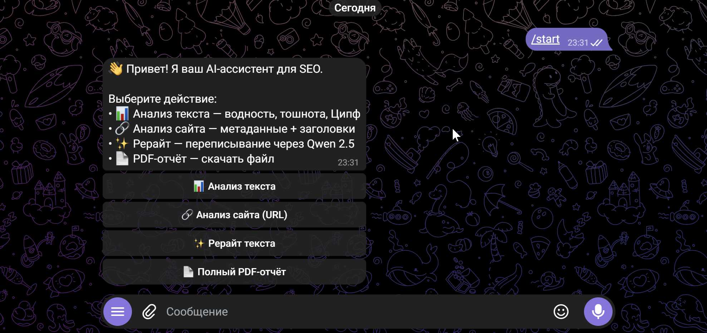

# 🤖 SEO-анализатор Telegram-бот

Telegram-бот для автоматического аудита сайтов с генерацией PDF-отчётов. Анализирует ключевые SEO-параметры и возвращает структурированный отчёт прямо в чат.



## ✨ Возможности

- 📊 **Анализ сайта по URL** — мета-теги, заголовки, структура, скорость загрузки
- 📝 **SEO-отчёт в PDF** — готовый документ с рекомендациями
- 🔄 **Рерайт контента** — генерация уникального текста на основе анализа
- 🌐 **Мультиязычность** — анализ сайтов на русском и английском
- ⚡ **Быстрый ответ** — отчёт за 10-30 секунд в боте, либо в pdf файле(так аккуратнее)

## 🧠 Архитектура AI-компонента

Бот построен на **модульной архитектуре**, что позволяет гибко выбирать источник AI-модели:

### Локальный режим (по умолчанию)
- Работает на **Ollama** с локальной моделью (например, `qwen2.5:14b`)
- ✅ Полная приватность — данные не покидают ваш сервер
- ✅ Нет зависимости от внешних API и подписок
- ⚠️ Рерайт в локальном режиме — **тестовая версия**. Для продакшн-качества рекомендуется подключить внешнее API.

### Подключение внешнего API (рекомендуется для продакшна)
Бот поддерживает подключение **любого совместимого API** по выбору клиента:
- OpenAI API (GPT-4)
- Anthropic Claude API
- Google Gemini API
- YandexGPT API
- Любое OpenAI-совместимое API (vLLM, LM Studio и др.)

Достаточно указать `API_KEY` и `BASE_URL` в конфигурации — бот переключится на выбранный провайдер без изменения кода.

## 🛠 Технологии

`Python` · `python-telegram-bot` · `BeautifulSoup4` · `ReportLab` · `Ollama` · `OpenAI API (опционально)`

## 🚀 Быстрый старт

1. Клонируй репозиторий
2. `pip install -r requirements.txt`
3. Настрой `config.py`:
   ```python
   BOT_TOKEN = "your_telegram_bot_token"
   AI_MODE = "local"  # или "api"
   API_KEY = "sk-..."  # если AI_MODE = "api"
   BASE_URL = "https://api.openai.com/v1"

